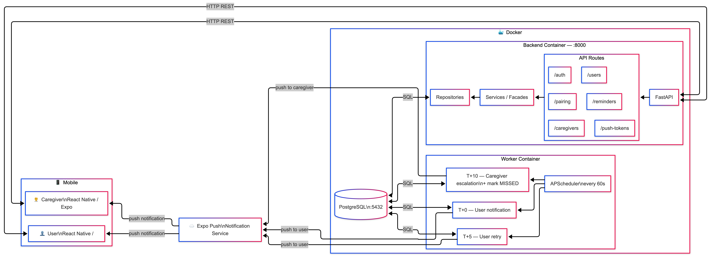

# Mnesya

Mobile reminder application for elderly people and their caregivers.

## Table of Contents

- [About](#about)
- [Sprint Planning](#sprint-planning)
- [Features](#features)
- [Architecture](#architecture)
- [Application Diagram](#application-diagram)
- [Database Schema](#database-schema)
- [Technologies](#technologies)
- [Installation](#installation)
- [Project Structure](#project-structure)
- [API Documentation](#api-documentation)
- [Development](#development)
- [Tests](#tests)
- [CI and dependency security](#ci-and-dependency-security)
- [Bug History](#bug-history)
- [Authors](#authors)
- [License](#license)

## Sprint Planning

> Track tasks, user stories and sprint progress on the project board:

🔗 [Mnesya Trello Board](https://trello.com/b/IqUf88wh/mnesya-project)

---

## About

Mnesya is a mobile reminder application designed to help elderly people (Users) and their caregivers, with a focus on simple and accessible use.

### Main Users

- **User (Elderly Person)**: Receives and responds to reminders
- **Caregiver**: Configures and manages profiles and reminders

### MVP Guiding Principles

- Ultra-simple interface for elderly people
- Large clickable areas and readable text (minimum 16px)
- Maximum 3 buttons per screen
- Linear journey without complex navigation

### MVP Scope - Current Implementation (May 12, 2026)

- **15 screens implemented**:
  - 1 Shared screen: WelcomeScreen
  - 9 Caregiver screens: LoginScreen, RegisterScreen, DashboardScreen, CaregiverProfileScreen, CreateProfileScreen, CreateReminderScreen, RemindersListScreen, UserProfileDetailScreen, CaregiverPillulierScreen
  - 2 Caregiver modal screens: CreateMedicationScreen
  - 4 User screens: UserPairingScreen, UserHomeScreen, ReminderNotificationScreen, UserPillulierScreen
- **Internationalization**: Full bilingual support (FR/EN) with i18next (months, week days, all pickers fully translated)
- **Enhanced Notifications**: Backend scheduler with 3 jobs (T+0, T+5, T+10 min) + automatic caregiver alerts
- **Activity Log**: Caregiver dashboard bell icon showing the last 48 h of user interactions (DONE/POSTPONED/UNABLE/MISSED) with unread badge
- **Rate Limiting**: Register (3/min) and Login (5/min) with user-facing modal on HTTP 429
- **Recurring Reminders**: DAILY / WEEKLY / MONTHLY recurrence with optional end date , full-stack feature (frontend modal UI + backend scheduler + Pydantic validation)
- **Medication Management (Pillulier)**: Full-stack medication feature , CRUD + automatic reminder generation + 7-day semainier for users
- **API Integration**: Frontend fully connected to backend (auth, profiles, pairing, reminders, reminder status, activity log, medication)
- **Code Quality**: ESLint v9 configured (0 errors, 0 warnings across all frontend files)
- **Current status**: Frontend 100% connected, Backend 100% (auth, profiles, pairing, reminders, reminder status, activity log, medication all live)
- **Detailed User Stories**: See [Technical Documentation \_ Mnesya.pdf](docs/Technical%20Documentation%20_%20Mnesya.pdf) (MoSCoW method, US-001 to US-027)

## Features

### Authentication (Caregiver)

- ✅ Caregiver account creation (email/password) - Fully integrated (frontend + backend)
- ✅ Secure JWT login - Fully integrated (frontend + backend)
- ✅ Token storage and management (tokenService with AsyncStorage)
- ✅ Automatic logout on token expiry

### Profile Management (Caregiver)

- ✅ User profile creation (first name, last name, date of birth, optional photo) - Fully integrated
- ✅ View and edit all managed profiles - Fully integrated
- ✅ Edit caregiver's own profile - Implemented (CaregiverProfileScreen)
- ✅ Pairing code generation (6 characters, valid 24h) - Fully integrated (frontend + backend)
- ✅ 6-character code input (react-native-confirmation-code-field)
- ✅ Bilingual interface (French/English) with i18next

### Reminder Management (Caregiver)

- ✅ Simple reminder creation (title, message, date, time) - Fully integrated (frontend + backend)
- ✅ Chronological reminder view with filters (date, profile, status) - Fully integrated
- ✅ Status tracking (Done, Pending, Postponed, Unable) - Fully integrated
- ✅ Tab navigation (Home | Reminders | Profile) - Implemented
- ✅ **Activity log**: Bell icon in caregiver dashboard header , displays the last 48 h of user interactions (DONE / POSTPONED / UNABLE / MISSED), with a red unread badge when new entries are detected and auto-reload on screen focus
- ✅ **Rate limiting feedback**: HTTP 429 from Register (3/min) or Login (5/min) triggers a dedicated `RateLimitModal` instead of a generic error
- ✅ **Recurring reminders**: DAILY / WEEKLY / MONTHLY recurrence with optional end date
  - Dedicated scheduling modal (`pageSheet`) for date, time and recurrence config
  - Day selector for WEEKLY (Monday → Sunday), inline display with `·` separator
  - Recurrence summary card on the main form (no scroll required)
  - Backend: `calculate_next_occurrence` + `schedule_next_occurrence` (APScheduler)
  - Pydantic validation: recurrence type required when `is_recurring`, days required for WEEKLY

### Medication Management / Pillulier (v1.3.0)

- ✅ Medication creation (name, dosage, DAILY/WEEKLY frequency, multiple times per day, start/end dates) , Fully integrated
- ✅ Automatic reminder generation , one `ReminderModel` per time slot, linked via `medication_id`
- ✅ Caregiver pillulier screen , profile selector, medication list with time badges, delete with confirmation
- ✅ User semainier , 7-day week view (Mon→Sun) with per-day status dots (DONE/MISSED/PENDING/POSTPONED), week navigation, "Aujourd'hui" badge
- ✅ Backend: `MedicationFacade`, `MedicationRepository`, Alembic migration 007 (table `medication` + FK on `reminder`)
- ✅ 44 backend unit tests + 33 frontend tests (medicationService, useMedications, useWeekSchedule)

### User Interface (Elderly Person)

- ✅ Pairing via 6-character code - Fully integrated (frontend + backend)
- ✅ Simple home screen with profiles and next reminder - Integrated with real API data
- ✅ Full-screen notification at reminder time - Implemented with Expo Notifications
  - Enhanced notification system (backend APScheduler + Expo Push):
  - 3 automatic repetitions (immediate T+0, retry T+5 min, escalation T+10 min)
  - Automatic caregiver alert if no response after 10 minutes
  - Smart notification cancellation when user responds
  - Badge count management on app icon
- 3 available actions:
  - Done (Green, #4CAF50) - Cancels all remaining notifications
  - Remind me later (Orange, #FF9800) - Triggers next repetition
  - Unable (Red, #F44336) - Sends immediate alert to caregiver
- ✅ Bilingual notifications (French/English)

## Architecture

### Application Diagram



### Database Schema


### Main Data Flows (Current Implementation)

1. ✅ **Caregiver Registration/Login**: Frontend → FastAPI (JWT) → PostgreSQL
   - Frontend: Fully integrated with authService + tokenService
   - Backend: `/api/auth/register` and `/api/auth/login` endpoints live

2. ✅ **Profile Management**: Frontend → FastAPI → PostgreSQL
   - Frontend: Integrated with real API via profileService
   - Backend: `/api/users` CRUD implemented

3. ✅ **User Pairing**: Frontend (Code entry) → FastAPI (Validation/expiration) → PostgreSQL
   - Frontend: Fully integrated with pairingService
   - Backend: `/api/pairing` generate and verify endpoints live

4. ✅ **Reminder Management**: Caregiver creates/edits/deletes reminders → Frontend → FastAPI → PostgreSQL
   - Frontend: Integrated with real API via reminderService
   - Backend: `/api/reminders` full CRUD implemented

5. ✅ **Status Update**: User responds → Frontend → FastAPI → PostgreSQL + notification cancellation
   - Frontend: Integrated with useReminderStatus hook
   - Backend: `/api/reminder-status/{id}` endpoint live

6. ✅ **Activity Log**: Caregiver opens dashboard bell → Frontend → FastAPI → PostgreSQL (JOIN reminder_status + reminder + user)
   - Frontend: `useActivityLog` hook + `ActivityLogModal` component, unread badge logic
   - Backend: `GET /api/reminder-status/caregiver/recent` , 48 h window, DONE/POSTPONED/UNABLE/MISSED only

## Technologies

### Frontend

- **Framework** : React Native 0.85.3 with Expo 56 (iOS/Android)
- **Language**: TypeScript 5.9
- **State Management** : React Hooks + AsyncStorage
- **Navigation** : React Navigation 7 (Stack + Bottom Tabs)
- **Internationalization**: i18next + react-i18next (FR/EN)
- **Notifications** : Expo Notifications (local scheduling with 4 automatic repetitions + caregiver alerts)
- **Code Quality**: ESLint v9 (flat config) with @typescript-eslint, eslint-plugin-react, eslint-plugin-react-hooks
- **UI Components**:
  - Custom date/time pickers (cross-platform)
  - Haptic feedback (expo-haptics)
  - 6-character code input (react-native-confirmation-code-field)
  - PIN view (react-native-pin-view)

### Backend - Fully Implemented

- **Framework** : Python 3.9+ with FastAPI 0.104.1
- **Database** : PostgreSQL 13+ with psycopg2-binary
- **ORM** : SQLAlchemy 2.0.50 with Alembic 1.12.1 (9 migration revisions in the repository)
- **Authentication** : JWT with python-jose , implemented
- **Async Tasks** : APScheduler 3.10.4 (3 background jobs every 60s)
  - **Push Notifications** : Expo Push Service (fully integrated)
- **Current Implementation Status**:
  - ✅ SQLAlchemy Models (Caregiver, User, Reminder, ReminderStatus, PushToken, PairingCode, Medication)
  - ✅ Persistence Repositories (BaseRepository + 7 domain-specific, incl. MedicationRepository)
  - ✅ Service Facades (caregiver, user, reminder, reminder_status, notification, medication)
  - ✅ Pydantic Schemas (caregiver, user, reminder, reminder_status, push_token, authentication, pairing_code, medication)
  - ⚠️ No `/health` endpoint is currently exposed; add it before relying on health-check supervision
  - ✅ JWT Authentication (`/api/auth/register`, `/api/auth/login`)
  - ✅ User profile CRUD (`/api/users`)
  - ✅ Caregiver profile management (`/api/caregivers`)
  - ✅ Pairing code generate + verify (`/api/pairing`)
  - ✅ Alembic migrations configured; application on an empty database still requires runtime verification
  - ✅ Docker Compose full setup (PostgreSQL + Backend + Worker)
  - ✅ pytest test suite (authentication, pairing, user, caregiver, reminder, reminder_status, push_notification, medication)
  - ✅ Reminder API endpoints (`/api/reminders`) , full CRUD
  - ✅ Reminder status update endpoint (`/api/reminder-status/{id}`)
  - ✅ Push token registration (`/api/push-tokens`) , register, unregister, list
  - ✅ APScheduler Worker , 3 jobs: T+0 user notification, T+5 retry, T+10 caregiver escalation
  - ✅ Rate limiting , Register: 3/min, Login: 5/min (SlowAPI)
  - ✅ Activity log endpoint (`GET /api/reminder-status/caregiver/recent`) , last 48 h, DONE/POSTPONED/UNABLE/MISSED
  - ✅ Medication CRUD + auto-generation of reminders (`/api/medication`) , create, list by user, get, update, delete
  - ✅ Medication semainier endpoint (`GET /api/medication/week`) , 7-day schedule with per-entry status

### Infrastructure

- ✅ **Containerisation** : Docker & Docker Compose (fully configured with PostgreSQL, Backend, Worker services)
- ⚠️ **CI/CD** : Not yet configured
- ⚠️ **Environments** : Dev, Staging, Production (to be configured)

## Installation

### Current Status (Mar 2, 2026)

**Frontend**: Fully operational , connected to real backend (auth, profiles, pairing, reminders, reminder status, activity log)
**Backend**: Fully operational , all MVP endpoints live
**Docker**: Fully configured with PostgreSQL, Backend, and Worker services

### Prerequisites

- Node.js 16+ and npm/yarn
- Python 3.9+ (if manual installation)
- PostgreSQL 13+ (if manual installation)
- Docker and Docker Compose (recommended)

### Installation with Docker (Recommended)

```bash
# Clone the repository
git clone <repository-url>
cd mnesya

# Start the full environment (PostgreSQL + Backend + Worker)
cd docker
docker-compose up -d

# Check services status
docker-compose ps

# View logs
docker-compose logs -f backend
```

The backend will be available at `http://localhost:8000`.
The current application has no `/health` endpoint. Use the root endpoint only as a basic reachability check until a dedicated health route is implemented.

### Manual Installation

#### Backend Setup

```bash
cd backend

# Create a virtual environment
python -m venv venv
source venv/bin/activate  # Linux/Mac
# or
venv\Scripts\activate  # Windows

# Install dependencies
pip install -r requirements.txt

# Configure environment variables
# Create a .env file at the root of /backend with the required variables
# (DATABASE_URL, SECRET_KEY)

# Initialize the database
alembic upgrade head

# Start the server
uvicorn app.main:app --reload
```

#### Frontend Setup

```bash
cd frontend

# Install dependencies
npm install

# Start Expo development server
npm start

# Run on iOS (Mac only)
npm run ios

# Run on Android
npm run android
```

## Project Structure

```text
mnesya/
├── backend/                    # Backend API Python/FastAPI
│   ├── app/
│   │   ├── main.py            # FastAPI application entry point
│   │   ├── config.py          # Database and app configuration
│   │   ├── __init__.py        # App factory and database initialization
│   │   ├── api/               # Route handlers
│   │   │   ├── authentication.py      # /api/auth (register, login, JWT)
│   │   │   ├── caregiver.py           # /api/caregivers (profile management)
│   │   │   ├── user.py                # /api/users (profile CRUD)
│   │   │   ├── pairing.py             # /api/pairing (generate + verify)
│   │   │   ├── reminder.py            # /api/reminders (full CRUD)
│   │   │   ├── reminder_status_api.py # /api/reminders/{id}/status
│   │   │   ├── push_notification.py   # /api/push-tokens (register, unregister, list)
│   │   │   └── medication.py          # /api/medication (CRUD + semainier)
│   │   ├── models/            # SQLAlchemy ORM models
│   │   │   ├── caregiver.py
│   │   │   ├── user.py
│   │   │   ├── reminder.py
│   │   │   ├── reminder_status.py
│   │   │   ├── reminder_status_enum.py
│   │   │   ├── push_token.py
│   │   │   ├── pairing_code.py
│   │   │   └── medication.py
│   │   ├── persistence/       # Repository pattern (data access layer)
│   │   │   ├── base_repository.py
│   │   │   ├── caregiver_repository.py
│   │   │   ├── user_repository.py
│   │   │   ├── pairing_code_repository.py
│   │   │   ├── reminder_repository.py
│   │   │   ├── reminder_status_repository.py
│   │   │   └── push_token_repository.py
│   │   ├── services/          # Business logic (facade pattern)
│   │   │   ├── caregiver_facade.py
│   │   │   ├── user_facade.py
│   │   │   ├── reminder_facade.py
│   │   │   ├── reminder_status_facade.py
│   │   │   ├── notification_services.py  # Expo Push SDK integration
│   │   │   └── medication_facade.py      # Medication CRUD + reminder generation
│   │   ├── schemas/           # Pydantic validation schemas
│   │   │   ├── authentication_schema.py
│   │   │   ├── caregiver_schema.py
│   │   │   ├── user_schema.py
│   │   │   ├── pairing_code_schema.py
│   │   │   ├── reminder_schema.py
│   │   │   ├── reminder_status_schema.py
│   │   │   └── push_token_schema.py
│   │   └── test/              # pytest test suite
│   │       ├── test_authentication_api.py
│   │       ├── test_caregiver_api.py
│   │       ├── test_pairing_api.py
│   │       ├── test_user_api.py
│   │       ├── test_reminder_api.py
│   │       ├── test_reminder_status_api.py
│   │       ├── test_push_notification_api.py
│   │       ├── test_recurrence.py          # Recurrence unit tests (24 tests, no DB required)
│   │       └── test_medication.py          # Medication unit tests (44 tests, no DB required)
│   ├── worker/                # APScheduler background jobs
│   │   └── scheduler.py       # 3 jobs: T+0 notify, T+5 retry, T+10 escalate
│   ├── alembic/               # Database migrations
│   │   └── versions/          # 3 migrations
│   ├── alembic.ini
│   ├── requirements.txt
│   └── pytest.ini
├── frontend/                  # React Native + Expo + TypeScript Mobile App
│   ├── src/
│   │   ├── App.tsx            # Root component with i18n + context
│   │   ├── i18n.ts            # i18next configuration (FR/EN)
│   │   ├── components/        # Reusable UI components
│   │   │   ├── ActivityLogModal.tsx        # Caregiver activity log (last 48 h)
│   │   │   ├── ChangePasswordModal.tsx
│   │   │   ├── ConfirmationModal.tsx
│   │   │   ├── FilterPickerModal.tsx
│   │   │   ├── MenuModal.tsx
│   │   │   ├── PairingCodeModal.tsx
│   │   │   ├── PlatformDatePicker.tsx      # Fully translated calendar picker
│   │   │   ├── PlatformTimePicker.tsx
│   │   │   ├── RateLimitModal.tsx          # HTTP 429 user feedback modal
│   │   │   ├── ReminderCard.tsx
│   │   │   ├── UpdateUserProfileModal.tsx
│   │   │   └── UpdateCaregiverProfileModal.tsx
│   │   ├── contexts/          # React contexts
│   │   │   └── RefreshContext.tsx  # Global refresh trigger
│   │   ├── hooks/             # Custom React hooks
│   │   │   ├── useActivityLog.ts           # Activity log fetch + unread logic
│   │   │   ├── useAuth.ts                  # Auth state (login/logout/register, rate-limit detection)
│   │   │   ├── useFormValidation.ts        # Form validation logic
│   │   │   ├── useCaregiverProfile.ts
│   │   │   ├── useUserProfile.ts
│   │   │   ├── useUserProfiles.ts
│   │   │   ├── useUserReminders.ts         # Reminders list for users
│   │   │   ├── useCaregiverReminders.ts    # Reminders with caregiver context
│   │   │   └── useReminderStatus.ts        # Reminder status updates
│   │   ├── locales/           # i18n translation files
│   │   │   ├── en.json
│   │   │   └── fr.json
│   │   ├── navigation/
│   │   │   ├── AppNavigator.tsx    # Main stack navigator
│   │   │   ├── CaregiverTabs.tsx   # Bottom tabs (Home | Reminders | Profile)
│   │   │   └── UserTabs.tsx        # Bottom tabs (Home | Profile)
│   │   ├── screens/           # 12 application screens
│   │   │   ├── WelcomeScreen.tsx
│   │   │   ├── LoginScreen.tsx
│   │   │   ├── RegisterScreen.tsx
│   │   │   ├── DashboardScreen.tsx
│   │   │   ├── CaregiverProfileScreen.tsx
│   │   │   ├── CreateProfileScreen.tsx
│   │   │   ├── CreateReminderScreen.tsx
│   │   │   ├── RemindersListScreen.tsx
│   │   │   ├── UserProfileDetailScreen.tsx
│   │   │   ├── UserPairingScreen.tsx
│   │   │   ├── UserHomeScreen.tsx
│   │   │   └── ReminderNotificationScreen.tsx
│   │   ├── services/          # API service layer
│   │   │   ├── api.ts              # Axios client with JWT interceptors
│   │   │   ├── authService.ts      # register, login (JWT)
│   │   │   ├── tokenService.ts     # JWT storage + retrieval
│   │   │   ├── profileService.ts   # Profile CRUD
│   │   │   ├── reminderService.ts  # Reminder CRUD
│   │   │   └── pairingService.ts   # Pairing code generate + verify
│   │   ├── styles/
│   │   │   └── commonStyles.ts     # Shared style definitions
│   │   ├── types/
│   │   │   ├── index.ts
│   │   │   ├── interfaces.ts
│   │   │   └── declaration.d.ts
│   │   ├── config/
│   │   │   └── api.ts              # Base API URL (auto-detects local IP in dev)
│   │   ├── utils/
│   │   │   ├── animations.ts       # Bell swing + pulse animations
│   │   │   ├── dateUtils.ts        # Age calculation from birthday
│   │   │   ├── notifications.ts    # Expo Notifications setup + repetitions
│   │   │   ├── recurrenceUtils.ts  # Recurrence display helpers (formatDate, getRecurrenceDescription…)
│   │   │   └── validation.ts       # Form field validation functions
│   │   └── data/
│   │       └── fakeData.ts         # Mock data for local testing
│   ├── assets/
│   ├── archives/              # Archived legacy components
│   ├── app.json
│   ├── babel.config.js
│   ├── jest.config.js
│   ├── jest.setup.js
│   ├── tsconfig.json
│   ├── eslint.config.js
│   ├── index.tsx
│   └── package.json
├── docker/                    # Docker configuration
│   ├── docker-compose.yml     # PostgreSQL + Backend + Worker services
│   └── README.md
├── docs/                      # Documentation
│   ├── Technical Documentation _ Mnesya.pdf
│   ├── Project Planning.pdf
│   ├── Team Formation and Idea Development Outline.pdf
│   ├── bug-report.md          # Bug tracking and solutions
│   ├── unit-testing-journey.md
│   ├── test-warnings-resolution.md
│   ├── trello-status.md
│   └── img/
├── README.md
└── .gitignore
```

## API Documentation

> Base URL: `http://localhost:8000`
> Interactive docs: `http://localhost:8000/docs` (Swagger UI)

### Authentication

| Endpoint             | Method | Description            | Auth |
| -------------------- | ------ | ---------------------- | ---- |
| `/api/auth/register` | POST   | Caregiver registration | No   |
| `/api/auth/login`    | POST   | Login (returns JWT)    | No   |
| `/api/auth/me`       | GET    | Get current caregiver  | Yes  |

### Caregiver Profile

| Endpoint               | Method | Description              | Auth            |
| ---------------------- | ------ | ------------------------ | --------------- |
| `/api/caregivers/{id}` | GET    | Get caregiver profile    | Yes (Caregiver) |
| `/api/caregivers/{id}` | PUT    | Update caregiver profile | Yes (Caregiver) |

### User Profiles (Elderly)

| Endpoint          | Method | Description           | Auth            |
| ----------------- | ------ | --------------------- | --------------- |
| `/api/users`      | POST   | Create a user profile | Yes (Caregiver) |
| `/api/users`      | GET    | List all profiles     | Yes (Caregiver) |
| `/api/users/{id}` | GET    | Get a profile         | Yes (Caregiver) |
| `/api/users/{id}` | PUT    | Update a profile      | Yes (Caregiver) |
| `/api/users/{id}` | DELETE | Delete a profile      | Yes (Caregiver) |

### Pairing

| Endpoint                | Method | Description                      | Auth            |
| ----------------------- | ------ | -------------------------------- | --------------- |
| `/api/pairing/generate` | POST   | Generate 6-char code (24h valid) | Yes (Caregiver) |
| `/api/pairing/verify`   | POST   | Verify code and receive JWT      | No              |

### Reminders

| Endpoint                      | Method | Description              | Auth            |
| ----------------------------- | ------ | ------------------------ | --------------- |
| `/api/reminder`               | POST   | Create a reminder        | Yes (Caregiver) |
| `/api/reminder/caregiver`     | GET    | List caregiver reminders | Yes (Caregiver) |
| `/api/reminder/user`          | GET    | List user reminders      | Yes (User)      |
| `/api/reminder/{id}`          | PUT    | Update a reminder        | Yes (Caregiver) |
| `/api/reminder/{id}`          | DELETE | Delete a reminder        | Yes (Caregiver) |
| `/api/reminder/{id}/postpone` | PUT    | Postpone a reminder      | Yes (User)      |

### Reminder Status

| Endpoint                                | Method | Description                           | Auth            |
| --------------------------------------- | ------ | ------------------------------------- | --------------- |
| `/api/reminder-status/{id}/current`     | GET    | Get current status of a reminder      | Yes             |
| `/api/reminder-status/{id}/history`     | GET    | Get full status history of a reminder | Yes             |
| `/api/reminder-status/{id}`             | PUT    | Update status (Done/Postponed/Unable) | Yes (User)      |
| `/api/reminder-status/caregiver/recent` | GET    | Activity log , last 48 h interactions | Yes (Caregiver) |
| `/api/reminder-status/valid-statuses`   | GET    | List all valid status values          | Yes             |

### Push Notifications

| Endpoint                      | Method | Description                | Auth                    |
| ----------------------------- | ------ | -------------------------- | ----------------------- |
| `/api/push-tokens/register`   | POST   | Register device push token | Yes (Caregiver or User) |
| `/api/push-tokens/unregister` | DELETE | Remove device push token   | Yes (Caregiver or User) |
| `/api/push-tokens/my-tokens`  | GET    | List my registered tokens  | Yes (Caregiver or User) |

### Medication (Pillulier)

| Endpoint                        | Method | Description                                      | Auth            |
| ------------------------------- | ------ | ------------------------------------------------ | --------------- |
| `/api/medication`               | POST   | Create medication + auto-generate reminders      | Yes (Caregiver) |
| `/api/medication/week`          | GET    | 7-day semainier for authenticated user           | Yes (User)      |
| `/api/medication/user/{id}`     | GET    | List medications for a user                      | Yes (Caregiver) |
| `/api/medication/{id}`          | GET    | Get a medication by ID                           | Yes             |
| `/api/medication/{id}`          | PUT    | Update medication (regenerates reminders)        | Yes (Caregiver) |
| `/api/medication/{id}`          | DELETE | Delete medication and linked reminders           | Yes (Caregiver) |

### Request Examples

#### Caregiver Registration

```json
POST /api/auth/register
{
  "email": "caregiver@example.com",
  "password": "SecurePass123",
  "first_name": "John",
  "last_name": "Doe"
}
```

#### Generate Pairing Code

```json
POST /api/pairing/generate
Authorization: Bearer <caregiver_token>
{
  "user_id": "uuid-of-profile"
}
```

#### Verify Pairing Code (User login)

```json
POST /api/pairing/verify
{
  "code": "ABC123"
}
```

#### Reminder Creation

```json
POST /api/reminders
Authorization: Bearer <caregiver_token>
{
  "user_id": "uuid-of-profile",
  "title": "Take medications",
  "description": "Don't forget to take morning medications",
  "scheduled_at": "2026-02-20T09:00:00"
}
```

**Possible reminder statuses**:

- `Done`: Task completed
- `Pending`: Reminder not yet processed
- `Postponed`: Reminder snoozed
- `Unable`: Task impossible, alert caregiver

## Development

### Git Branching Strategy

The project uses a simplified Gitflow workflow:

- **main**: Stable branch, reflects production code
- **dev**: Main integration branch
- **front/feat/\***: Frontend feature branches (e.g., `front/feat/auth-integration`)
- **back/feat/\***: Backend feature branches (e.g., `back/feat/api-authentication`)

### Workflow

1. Create a `front/feat/*` or `back/feat/*` branch from `dev`
2. Develop and commit
3. Create a Pull Request to `dev`
4. Code review by the other developer
5. Merge into `dev`
6. Once validated, PR from `dev` to `main`

### Commit Conventions

```text
feat(api): add POST /reminders endpoint
fix(frontend): resolve navigation issue
docs: update README
```

### Design System

#### Typography

- **Headings (H1)**: 24px, Bold
- **Body text**: 16px minimum, Regular
- **Buttons**: 18px, Medium

#### Spacing

- Minimum button height: **56px**
- Minimum clickable areas: 44x44px

#### Color Palette

- **Primary Blue**: #4A90E2 (navigation, main actions)
- **Success Green**: #4CAF50 (Done button)
- **Warning Orange**: #FF9800 (Remind later button)
- **Error Red**: #F44336 (Unable button)
- High contrast for accessibility (WCAG AA)

#### UX Constraints

- Maximum 3 buttons per screen
- Linear journey without complex navigation

## Tests

### Backend (Python/FastAPI)

**📋 Complete Test Documentation**: [backend/app/test/README.md](backend/app/test/README.md)

**Test Suite**: 234 backend tests across the API and domain suites.
**Current status**: The CI backend gate compiles, lints, audits dependencies, and runs the Docker regression suite. The medication API accepts both the current `moments` representation and the legacy `times` representation during migration.

```bash
cd backend

# Run all tests (requires Docker , see docker/docker-compose.test.yml)
docker-compose -f docker/docker-compose.test.yml up --build --abort-on-container-exit

# Run recurrence unit tests locally (no database required)
PYTHONPATH=. venv/bin/pytest app/test/test_recurrence.py -v --noconftest
```

#### Backend Test Files

**API Integration Tests (166 tests)**:

- `test_authentication_api.py` , Register, login, token validation (19 tests)
- `test_caregiver_api.py` , Caregiver profile CRUD (14 tests)
- `test_pairing_api.py` , Generate and verify pairing codes (18 tests)
- `test_user_api.py` , User profile CRUD (27 tests)
- `test_reminder_api.py` , Reminder CRUD endpoints (36 tests)
- `test_reminder_status_api.py` , Reminder status update endpoint (32 tests)
- `test_push_notification_api.py` , Push token register, unregister, list (20 tests)

**Unit Tests (154 tests)**:

- `test.py` , Models validation, schemas validation, business logic, entity relationships
  - Model tests (65): User, Caregiver, Reminder, ReminderStatus
  - Schema tests (49): Create/Update validation
  - Integration tests (16): Edge cases and model interactions
- `test_recurrence.py` , Recurrence logic unit tests (24 tests)
  - `calculate_next_occurrence`: DAILY, WEEKLY, MONTHLY, end date cutoff, edge cases
  - `schedule_next_occurrence`: DB interaction, returns True/False
  - `ReminderCreate` schema: recurrence validation rules (all 9 cases)
- `test_medication.py` , Medication unit tests (44 tests, no database required)
  - `MedicationFacade.create_medication`: DAILY/WEEKLY, multiple times, reminder auto-generation
  - `MedicationFacade.get_week`: semainier 7 days, status resolution, past/present/future
  - `MedicationCreate` schema: WEEKLY/recurrence_days cross-validation, HH:MM format

**Tool**: pytest + SQLAlchemy test database

### Frontend (React Native + Jest)

**📋 Complete Test Documentation**: [frontend/README-tests.md](frontend/README-tests.md)

**Test Suite**: 20 suites are declared in the repository.
**Current status**: Jest runs with the configured React Native preset and the CI frontend gate also runs ESLint, TypeScript, and the high-severity npm audit.

```bash
cd frontend

# Run all tests
npm test

# With coverage report
npm test -- --coverage
```

#### Frontend Test Files (283 tests across 20 suites)

- `__tests__/hooks/useFormValidation.test.ts` , Form validation hook (18 tests)
- `__tests__/utils/validation.test.ts` , Validation utility functions (42 tests)
- `services/__tests__/authService.test.ts` , register, login API calls (24 tests)
- `services/__tests__/tokenService.test.ts` , JWT storage and retrieval (11 tests)
- `services/__tests__/reminderService.test.ts` , Reminder CRUD + recurring payloads (19 tests)
- `services/__tests__/pairingService.test.ts` , Pairing code generate and verify (7 tests)
- `services/__tests__/profileService.test.ts` , User profile CRUD API calls (11 tests)
- `hooks/__tests__/useCaregiverProfile.test.ts` , Hook loading/error/reload behaviour (9 tests)
- `hooks/__tests__/useUserProfile.test.ts` , User profile hook behaviour (7 tests)
- `hooks/__tests__/useUserProfiles.test.ts` , Profiles list hook behaviour (6 tests)
- `hooks/__tests__/useUserReminders.test.ts` , Reminders list hook behaviour (6 tests)
- `hooks/__tests__/useCaregiverReminders.test.ts` , Caregiver reminders hook behaviour (6 tests)
- `hooks/__tests__/useReminderStatus.test.ts` , Reminder status hook behaviour (6 tests)
- `components/__tests__/UpdateUserProfileModal.test.tsx` , Modal rendering and validation (21 tests)
- `components/__tests__/UpdateCaregiverProfileModal.test.tsx` , Modal rendering and validation (16 tests)
- `utils/__tests__/validation.test.ts` , Form validation utility functions (42 tests)
- `utils/__tests__/recurrenceUtils.test.ts` , Recurrence display and validation helpers (35 tests)
  - `formatDate` / `formatTime`: padding, format DD/MM/YYYY and HH:MM
  - `getRecurrenceSummary`: DAILY / WEEKLY / MONTHLY / off state / no days / mutation guard
  - `getRecurrenceDescription`: all types, end date suffix, empty WEEKLY
  - `getSchedulingSummary`: with and without recurrence
  - `isRecurrenceValid`: WEEKLY/no days → false, all other cases → true
- `services/__tests__/medicationService.test.ts` , Medication CRUD + week schedule API calls (15 tests)
- `hooks/__tests__/useMedications.test.ts` , Loading, null userId guard, reload/silentReload (9 tests)
- `hooks/__tests__/useWeekSchedule.test.ts` , Week navigation, reload, auth error handling (9 tests)
- **Tools**: Jest + React Native Testing Library + ESLint v9

### Manual Tests

Acceptance criteria checklist to verify before each Production deployment:

#### Functional

- [x] A caregiver can create an account and log in
- [x] A caregiver can create and edit a user profile
- [ ] A caregiver can generate and verify a 5-minute pairing code in the deployed version
- [x] A user can pair with the code and receive a JWT
- [x] A caregiver can create a one-shot reminder
- [x] A caregiver can create a recurring reminder (DAILY / WEEKLY / MONTHLY) with optional end date
- [x] A recurring reminder automatically reschedules after each completion
- [x] A user receives a full-screen notification at reminder time
- [x] A user can respond Done/Remind Later/Unable
- [x] "Remind later" triggers a new local notification
- [x] "Unable" sends an immediate alert to the caregiver

#### Design

- [x] All texts are readable (minimum 16px)
- [x] All buttons respect 56px minimum height
- [x] Maximum 3 actions per screen
- [x] Clear and linear navigation
- [x] Contrasted colors (WCAG AA accessibility test)

#### Technical

- [x] JWT token is stored and restored correctly across sessions
- [ ] Pairing code expiration and single use are verified against the deployed version
- [x] Notifications work when the app is in the background
- [x] API errors are displayed gracefully (no crashes)

## CI and dependency security

The workflow in `.github/workflows/ci.yml` runs on pull requests and pushes targeting `dev` or `main`.
It validates Docker configuration, backend compilation/lint/tests, frontend lint/typecheck/tests, and dependency audits.

The backend audit explicitly records `PYSEC-2026-1325` as an exception because it affects the latest `ecdsa` release pulled by `python-jose` and has no fixed release yet. The frontend lockfile overrides `image-size` to a fixed release; the remaining Expo transitive findings are moderate and require a breaking Expo downgrade, so they remain tracked for an Expo upgrade cycle.

## MVP Exclusions

Features **not included** in v1.0 (postponed post-MVP):

- ✅ ~~Recurring reminders (daily, weekly, monthly)~~ , **Implemented in v1.2.0**
- ❌ Graphical calendar view
- ❌ Statistics and graphs
- ❌ Voice messages in reminders
- ❌ Home screen widget
- ❌ Emergency button
- ❌ Advanced settings (custom notification sounds, vibrations, etc.)
- ❌ Images in reminders

These features are documented in the User Stories (US-020 to US-028) as **WON'T HAVE** for the MVP.

---

## Bug History

A detailed log of identified bugs, their root cause, and applied fixes is maintained in this document:

🔗 [Bug History - Google Docs](https://docs.google.com/document/d/1sl_qg3E7czLrGO45kJ_kkh6UvvIU0ALRUtCR6lTpcEI/edit?usp=sharing)

---

## Authors

- **Mickael MUR**
- **Jordann MISO**

---

## License

This project is licensed under the MIT License.

```text
MIT License

Copyright (c) 2026 Mickael MUR, Jordann MISO

Permission is hereby granted, free of charge, to any person obtaining a copy
of this software and associated documentation files (the "Software"), to deal
in the Software without restriction, including without limitation the rights
to use, copy, modify, merge, publish, distribute, sublicense, and/or sell
copies of the Software, and to permit persons to whom the Software is
furnished to do so, subject to the following conditions:

The above copyright notice and this permission notice shall be included in all
copies or substantial portions of the Software.

THE SOFTWARE IS PROVIDED "AS IS", WITHOUT WARRANTY OF ANY KIND, EXPRESS OR
IMPLIED, INCLUDING BUT NOT LIMITED TO THE WARRANTIES OF MERCHANTABILITY,
FITNESS FOR A PARTICULAR PURPOSE AND NONINFRINGEMENT. IN NO EVENT SHALL THE
AUTHORS OR COPYRIGHT HOLDERS BE LIABLE FOR ANY CLAIM, DAMAGES OR OTHER
LIABILITY, WHETHER IN AN ACTION OF CONTRACT, TORT OR OTHERWISE, ARISING FROM,
OUT OF OR IN CONNECTION WITH THE SOFTWARE OR THE USE OR OTHER DEALINGS IN THE
SOFTWARE.
```

---

Developed to make life easier for elderly people and their caregivers.
