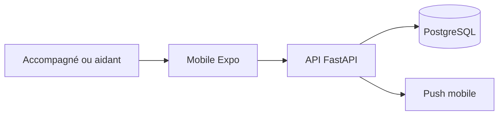

# Architecture technique

## Décisions et contraintes structurantes

Le mobile utilise React Native avec Expo pour partager le parcours iOS/Android. L'API utilise FastAPI, PostgreSQL et SQLAlchemy/Alembic. Docker Compose fournit l'exécution reproductible et le déploiement cible reste un VPS avec Dokploy/Traefik. Cette baseline respecte le MVP existant; aucun mode hors ligne ni diagnostic médical n'est ajouté.

## Composants et responsabilités

| Composant | Responsabilité | Entrées | Sorties | Dépendances | Observabilité |
| --- | --- | --- | --- | --- | --- |
| Mobile Expo | Afficher profils, rappels, réponses et appairage | HTTPS/JSON, push | Actions utilisateur | API FastAPI, fournisseur push | logs client non sensibles |
| API FastAPI | Authentifier, autoriser, orchestrer rappels | JSON authentifié | JSON, événements, journal | PostgreSQL, push | `/health`, logs structurés |
| PostgreSQL | Persister profils, routines, médications et audit | transactions API | états durables | volume Docker, sauvegardes VPS | métriques DB et sauvegarde |
| Service push | Distribuer les notifications | jeton et payload minimal | accusé de remise | fournisseur mobile | erreurs et retries bornés |

## Diagramme de contexte et conteneurs

Les flux sont HTTPS entre mobile et API, SQL transactionnel entre API et base, et payload push minimal sans donnée médicale. L'appairage est contrôlé côté API par propriété et code temporaire.

## Flux critiques et résilience

Les écritures de réponse et de journal sont transactionnelles et idempotentes par identifiant d'action. Les push sont asynchrones, avec retries bornés et journalisation d'échec. Un timeout API est présenté comme erreur actionnable; aucune promesse de fonctionnement hors ligne n'est faite. `/health` vérifie la disponibilité minimale de l'API.

## Qualité technique

Les contrôles prioritaires sont propriété des ressources, révocation JWT, validation des entrées, tests pytest/Jest et audit sécurité. L'interface vise au moins 16 px, grandes zones tactiles et trois actions maximum pour répondre. La capacité reste celle du MVP et la rétention/sauvegarde de production demeure à valider humainement.
