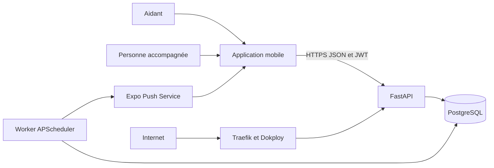

# Architecture technique

## Composants

| Composant | Responsabilité | Dépendances |
| --- | --- | --- |
| Application mobile React Native et Expo | interfaces aidant et personne accompagnée, stockage local de jetons, notifications | API HTTPS, Expo notifications |
| API FastAPI | authentification, règles de propriété, contrats REST et persistance | PostgreSQL, variables d environnement |
| PostgreSQL | comptes, profils, rappels, statuts, tokens push, révocations, médicaments | volume Docker en production |
| Worker APScheduler | recherche des rappels dus, répétitions et escalades | PostgreSQL, service Expo |
| Dokploy et Traefik | déploiement et routage HTTPS de l API | VPS et réseau Docker |

## Flux et résilience

Les migrations Alembic sont appliquées avant le serveur dans les commandes de conteneur. Le worker est optionnel dans le compose de production. Les envois push dépendent d un service externe et ne démontrent pas la réception sur appareil. Aucun mécanisme hors ligne n est documenté. La route `/health` annoncée par le README est absente du code et répond `404` en production.

## Qualité technique

Le frontend est linté avec ESLint. Les tests backend sont conçus pour le compose de test avec PostgreSQL temporaire. Les tests frontend sont actuellement bloqués par le preset Jest React Native manquant. Aucune CI exécutable n a été détectée.
