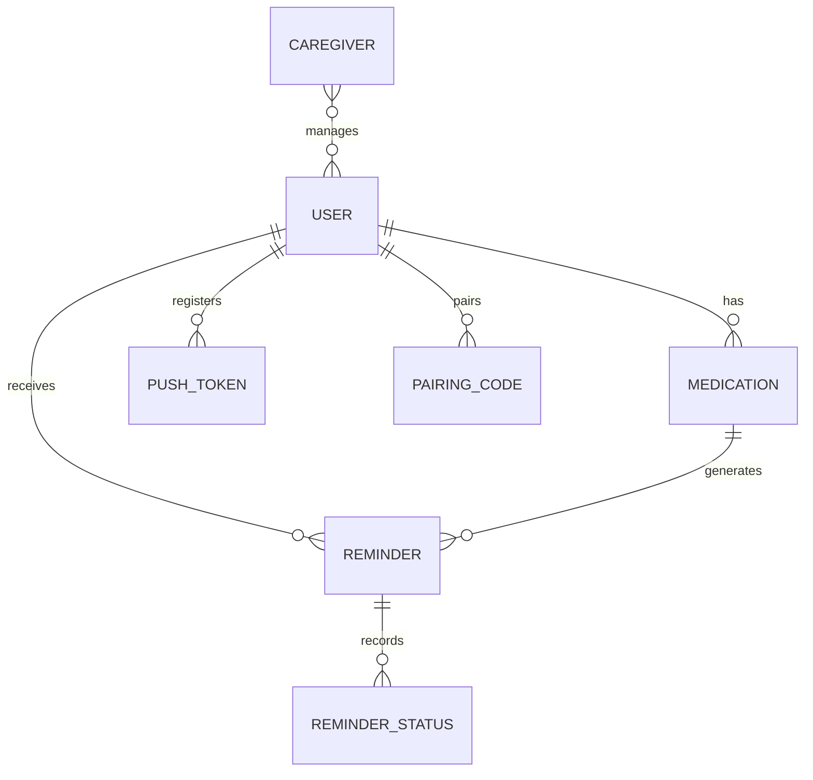

# Modèle de données

## Classification et cycle de vie

| Entité | Données | Sensibilité | Usage |
| --- | --- | --- | --- |
| Caregiver | identité, email, hash de mot de passe | personnelle | accès et propriété |
| User | identité, date de naissance, profils aidants | personnelle sensible par précaution | rappel et appairage |
| Reminder et ReminderStatus | contenu, horaires, réponses | routine potentiellement sensible | planification et historique |
| Medication | nom, dosage, fréquence et périodes | donnée de santé potentielle | pillulier et rappels |
| PushToken et PairingCode | identifiant de terminal et code temporaire | secret opérationnel | notification et appairage |

La durée de conservation, les modalités d effacement et les sauvegardes de production ne sont pas établies par les sources disponibles. Elles restent à définir avant diffusion élargie.

## Entités et invariants

`Caregiver` possède des `User`. Les rappels, médicaments et codes sont liés à un profil accompagné. Les accès sont contrôlés par propriété côté API. Les statuts de rappel utilisent notamment `PENDING`, `DONE`, `POSTPONED`, `UNABLE` et `MISSED`. Les jetons JWT possèdent un `jti` et peuvent être révoqués.

## Migrations et restauration

Les migrations sont gérées par Alembic et incluent la structure initiale, tokens push, révocation, index, récurrence, médicament, journal d escalade et renommage des moments. Une migration doit être testée sur une base vide et disposer d un plan de retour. La stratégie de sauvegarde réelle du VPS est inconnue et ne doit pas être supposée.
