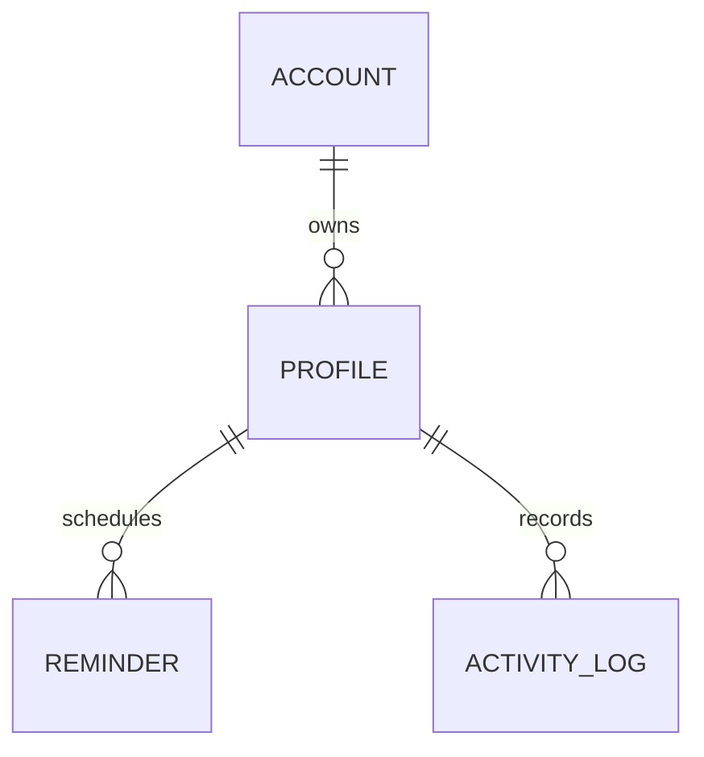

# Modèle de données

## Classification et cycle de vie

| Donnée ou entité | Sensibilité | Source | Usage | Rétention | Suppression | Responsable |
| --- | --- | --- | --- | --- | --- | --- |
| Compte aidant | sensible | aidant | authentification et propriété | rétention à valider | effacement à définir | demandeur |
| Profil accompagné | sensible | aidant | appairage et rappels | rétention à valider | effacement à définir | demandeur |
| Rappel/médication | sensible | aidant | routine et pilulier | rétention à valider | effacement à définir | demandeur |
| Journal d'activité | sensible | API | traçabilité | rétention à valider | effacement à définir | demandeur |

## Entités, attributs et règles

| Entité | Attributs clés | Identifiant | Relations | Contraintes et invariants |
| --- | --- | --- | --- | --- |
| Account | email, password hash, revoked tokens | UUID | owns profiles | email unique, hash bcrypt |
| Profile | name, pairing status | UUID | belongs to account; has reminders | ownership obligatoire |
| Reminder | schedule, status, medication reference | UUID | belongs to profile | états bornés, récurrence validée |
| ActivityLog | action, actor, timestamp | UUID | belongs to profile | append-oriented, no secrets |

## Diagramme de données

Les entités représentent le périmètre du MVP; les champs exacts restent alignés sur les modèles SQLAlchemy existants.

## Migrations, intégrité et sauvegarde

Les changements passent par Alembic, sont testés sur une base de test et doivent être réversibles avant déploiement. Les sauvegardes VPS et la procédure de restauration restent une décision de production à valider; aucune rétention n'est inventée.
