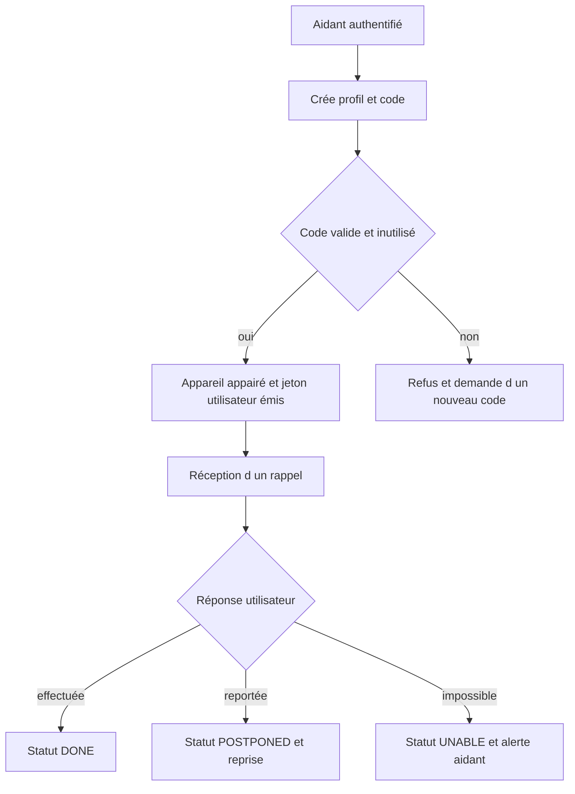

# Parcours critiques

## Appairage et réponse

## Gestion par l aidant

L aidant se connecte, crée ou sélectionne un profil dont il est propriétaire, crée ou modifie un rappel, puis consulte les statuts et l activité. Une authentification invalide, un UUID invalide ou un profil non détenu doit interrompre le parcours sans divulguer la donnée.

## Reprise

Le code expiré impose une nouvelle génération. Une notification manquée ne prouve pas une action utilisateur. L absence de support hors ligne est une limite ouverte : l interface doit signaler l erreur au lieu de confirmer une opération non synchronisée.
