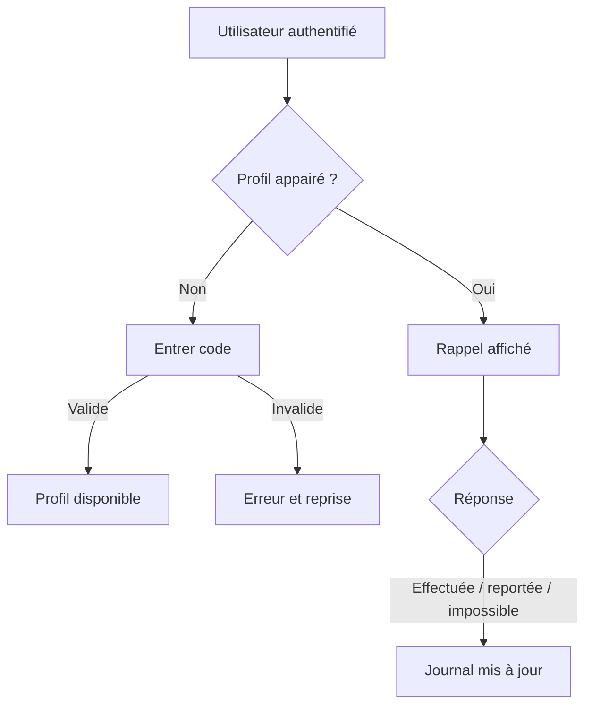

# Parcours utilisateur

## Inventaire des parcours

| ID | Déclencheur | Acteur | Résultat attendu | Échecs et reprises | Stories liées |
| --- | --- | --- | --- | --- | --- |
| FLOW-001 | aidant démarre un profil | aidant | profil appairé | code invalide, accès refusé | US-001 |
| FLOW-002 | rappel reçu | personne accompagnée | réponse journalisée | push manquant, action répétée | US-002, US-003 |

## Diagramme des parcours critiques

Les flux critiques couvrent appairage, réponse à un rappel et persistance du journal.

## Détails par parcours

### FLOW-001

- Préconditions : aidant authentifié et profil non appairé.
- Étapes nominales : créer profil, générer code, saisir code, confirmer appairage.
- Validations et erreurs : code borné et expiré selon règle à confirmer; ownership et erreurs réseau testés.
- Annulation, reprise et persistance : annulation sans création partielle; état persistant après succès.
- Critères de sortie : profil appairé et visible uniquement aux acteurs autorisés.
